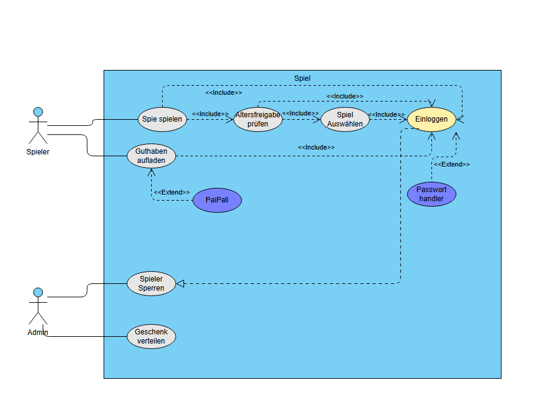
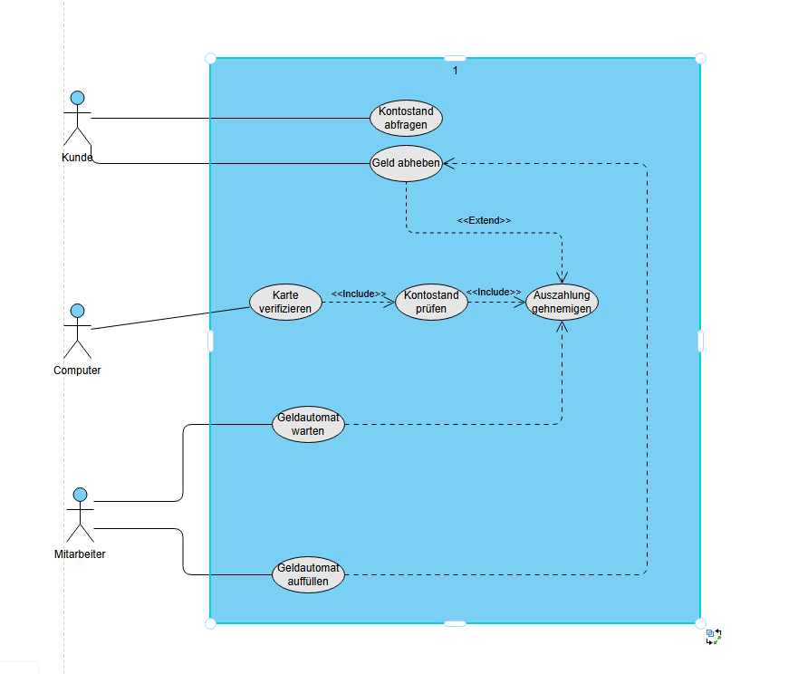

# **Software Engineering Laboraufgabe 3**

## Aufgabe 1

 - ## Vorteile:
    1. **Höhere Codequalität:**  Zwei Augen sehen mehr als eine: Fehler werden schneller erkannt. Außerdem entsteht so sauberer, lesbarer und wartbarer Code.

    2. **Besseres Wissensmanagement:** Neue Teammitglieder können besser gefördert werden da Wissen über verschiedenste Dinge (Libraries, Systeme, Kunden etc.) besser geteilt wird.

    3. **Schnellere Problemlösung:** Ideen und Lösungsansätze können direkt diskutiert werden. Kreativere und robustere Lösungen entstehen durch verschiedene Perspektiven.

    4. **Vermeidung von Engpässen:** Weniger Abhängigkeit von Einzelpersonen (Wissensinseln).

- ## Nachteile:
    1. **Höherer Zeitaufwand / Kosten:** Zwei Entwickler arbeiten an einer Aufgabe ergo doppelte Personalkosten über kürzere Zeit. Darüber hinaus profitiert nicht jede Aufgabe vom doppelten Aufwand.

    2. **Unterschiedlicher Fähigkeiten-/Wissensstand:** Ungleichgewicht kann zu Frustration führen: einer langweilt sich, der andere fühlt sich überfordert. Dadurch kann es zu Fehlern bei der Rollenverteiling kommen, wodurch ein Mitglied unproduktiv sein/wirken könnte.

    3. **Mentale Ermüdung:** Dauerhafte Konzentration auf hohem Level und zusammenarbeit mit anderen ist, auf dauer, anstrengend. Deswegen sind regelmäßige Pausen und/oder Rollentausche wichtig.

    4. **Soziale Spannungen:** Persönliche Differenzen oder schlechte Kommunikation können frustrieren und die Zusammenarbeit erschweren.

---

 

## Aufgabe 2

### 1. Kompatibilität:
> Die Benutzeroberfläche muss auf allen gängigen Betriebssystemen (iOS, Android, Windows, macOS) und in gängigen Browsern responsive und voll funktionsfähig sein.

**Begründung:**

Die Nutzer sollen über verschiedene Endgeräte (Smartphone, Tablet, PC, etc.) auf den Bot zugreifen können. Daraus ergibt sich die Notwendigkeit, dass die Benutzeroberfläche auf verschiedenen Betriebssystemen und Bildschirmgrößen funktioniert.

### 2. Zuverlässigkeit
> Das System muss eine Uptime (Betriebszeit) von mindestens 95% gewährleisten, damit die Pflege des Beetes kontinuierlich erfolgen kann.

**Begründung**

Da der Beetbot zentrale Aufgaben wie Wässern, Jäten und die Erkennung von Schädlingsbefall automatisch übernimmt, muss er zuverlässig funktionieren. Ein Ausfall des Systems kann selbst bei sporadischer Nutzung fatal für die Pflanzen sein.

### 3. Ressourcensparend / Effizienz
> Die Software auf dem Beetbot muss speichereffizient sein und darf nicht mehr als 70 % der verfügbaren Rechenleistung und 80 % des Speichers im Normalbetrieb beanspruchen.

**Begründung:**

Da der Beetbot begrenzte Hardwareressourcen besitzt und in C programmiert wird, muss der Code und die Kommunikation zwischen Roboter und Backend effizient gestaltet werden, um Hardwareressourcen wie Speicher und Rechenleistung optimal zu nutzen.

---

## Aufgabe 3 

### a)

### b)

1. **Use Case Name**

    - Spiel spielen
2. **Primary Actor**
    - Spieler
3. **Preconditions (Bedingungen)**
    - Der Spieler ist nicht gesperrt
    - Der Spieler ist erfoglreich angemeldet
    - Das gewünschte Spiel ist verfügbar
4. **Main Succes Scenario**
    - Der Spieler wählt ein Spiel aus der Spieleliste aus
    - Das System prüft die Altersfreigabe des Spiels gegen das Alter des Spielers
    - Wenn die Altersfreigabe erfüllt ist, startet das Spiel
    - Der Spieler spielt das Spiel
5. **Success Guarantee**
    - Der Spieler hatte nur Zugriff auf Altersgerechte Spiele
    - Das Spiel wurde gestartet und gespielt
6. **Extension**
    - Altersfreigabe nicht erfüllt:
        - Das System verweigert dem Spieler den Zugriff auf das Spiel, und informiert diesen darüber, dass er es aufgrund der Altersüberprüfung nicht spielen darf
    - Verbindungsabruch:
        - Das Spiel wird unterbrochen
    - Kunde wird während des Spielens gesperrt:
        - Spiel wird beendet und der Spieler bekommt eine Sperrmeldung
7. **Special Requirements**
    - Altersfreigaben müssen gesetzeskonform behandelt werden
    - Fehlerhafte Eingaben müssen benutzerfreundlich abgefangen werden.
    - Benutzeroberfläche soll klar und einfach bedienbar sein
    - Ladezeiten sollen minimal sein, damit das Spiel schnell startet

    

## Aufgabe 4

### a) 

| Eintrag  | Rolle   |
| -------- | ------- |
| Geldautomat  |  Zu erstellendes System |
| Kunde |  Stakeholder, Primary Actor | 
| Geldkarte |  Kein Actor |
| Bank | Stakeholder |
| Bedienpanel | Kein Actor |
| Besitzer der Bank | Stakeholder |
| Servicemitarbeiter |  Stakeholder, Unterstützender Actor |
| Drucker | Kein Actor |
| Hauptcomputersystem der Bank |  Unterstützender Actor  |
| Kassierer | Kein Actor |
| Bankräuber |  Kein Actor |

### b)

| Actor | Goal |
| ----- | ---- |
Kunde | Geld abheben
Kunde | Kontostand abfragen
Servicemitarbeiter | Geldautomat warten
Servicemitarveiter | Geldautomat auffüllen
Hauptcomputersystem der Bank | Kontostand prüfen
Hauptcomputersystem der Bank | Auszahlung genehmigen
Hauptcomputersystem der Bank | Karte verifizieren

### c)

