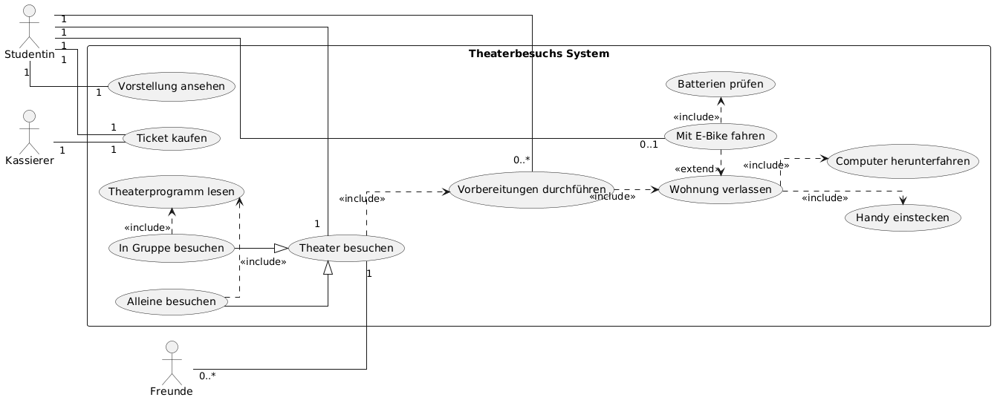
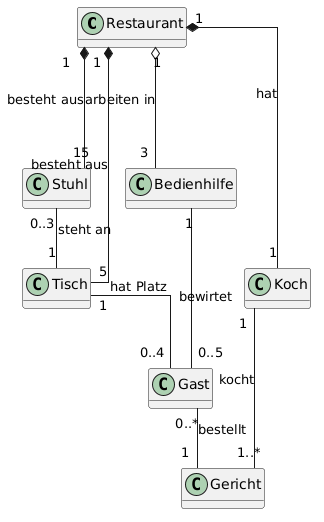
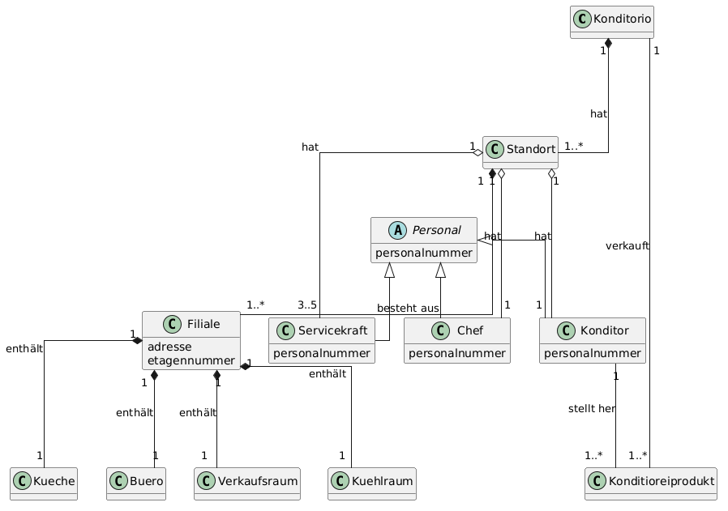
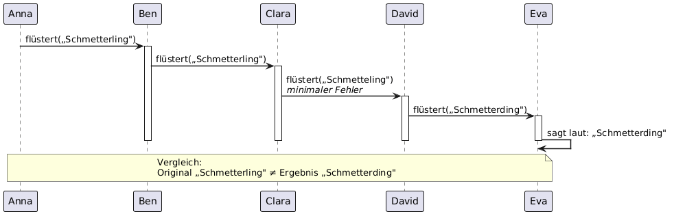

# **Software Engineering Laboraufgabe 4**

## Aufgabe 1

---

## Aufgabe 2

Konzeptklassen:  
Restaurant, Tisch, Stuhl, Bedienhilfe, Gast, Koch, Gericht

Konzeptmodell: 

---

## Aufgabe 3:
Konzeptklassen:  
Unternehmen (Konditorio), Standort, Filiale, Küche, Büro, Verkaufsraum, Kühlraum, Chef, Konditor, Servicekraft, Konditioreiprodukt

Konzeptmodell: 

***Konditorio Code befindet sich in dem Konditorio Projekt Ordner***

---

## Aufgabe 4
