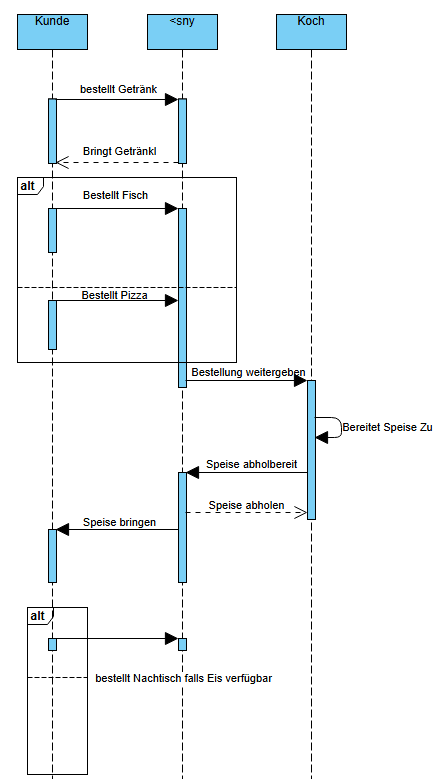
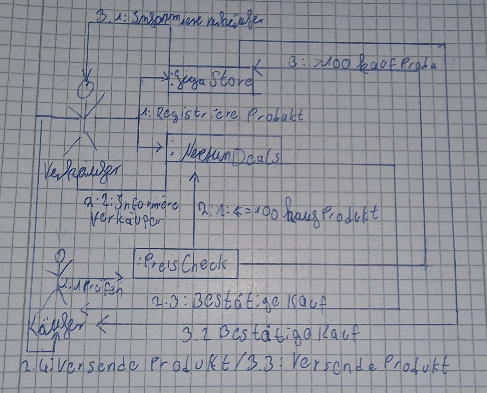
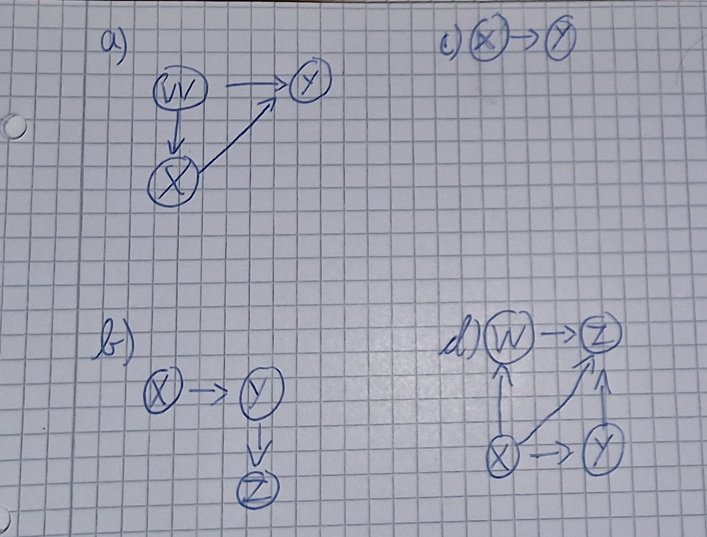

# **Software Engineering Laboraufgabe 5**

## Aufgabe 1

---

## Aufgabe 2

--- 

## Aufgabe 3

- **Koppelung:**
    Kopplung ist das Maß für Abhängigkeiten zwischen Klassen. Geringe Koppelung ist wünschenswert
- **Kohäsion:**
    Kohäsion ist das Maß für die Zusammengehörigkeit innerhalb einer Klasse. Hohe Köhasion ist wünschenswert.

---

## Aufgabe 4

#### a)
    W instanziiert X und nutzt Y als Methoden-Parameter
    X benutzt Y als Methoden-Paratmeter

#### b)
    X erbt von Y
    Y erbt von Z

#### c)
    X implementiert Y

#### d)
    X verwendet Z als Variable welche mit Y initialisiert
    Y implementiert Z
    X greift auf Methode von W zu
    W benutzt Z als Methoden-Parameter

---

    

## Aufgabe 5

### a)

- ArrayList und Iterator, beide aus dem Java Collections Framework 
    `Diese Klassen werden in der iterate Methode instanziiert`
- Runnable, ein Java-Interface
    `Die Klasse MyClass implementiert Runnable`
- CSVParser, aus externer Quelle
    `Wird am Anfang der Klasse instanziiert`

    

### b) 
Bei den Modulen ArrayList, Iterator und Runnable sollten keine Probleme auftauchen, da diese zur Standard Java-Library gehören.  
CSVParser hingegen stammt aus einer externen Quelle und könnte Probleme verursachen sollte sich zum Beispiel die Java-Version ändern.

---