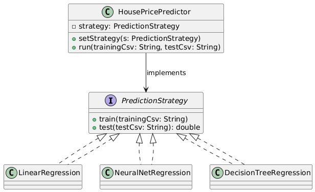
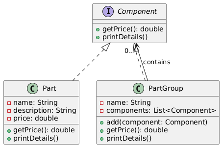

# **Software Engineering Laboraufgabe 7**

## Aufgabe 1

### a)
Da die  Algorithmen LinearRegression, NeuralNetworkRegression und DecisionTreeRegression austauschbar sind und die selbe funktionweise (Trainieren und Testen) aufweisen, eignet sich hier das `Strategy Pattern` am meisten.

### b)



### c)
Hier ist das benötigte Interace:

```
interface PredictionStrategy {
    void train(String trainingCsv);
    double test(String testCsv);
}
```
hier die Algorithmen

```
class LinearRegression implements PredictionStrategy {
    public void train(String trainingCsv) {
        System.out.println("Training LinearRegression with " + trainingCsv);
    }
    public double test(String testCsv) {
        System.out.println("Testing LinearRegression with " + testCsv);
        return 0.9;
    }
}

class NeuralNetRegression implements PredictionStrategy {
    public void train(String trainingCsv) {
        System.out.println("Training NeuralNetRegression with " + trainingCsv);
    }
    public double test(String testCsv) {
        System.out.println("Testing NeuralNetRegression with " + testCsv);
        return 0.85;
    }
}

class DecisionTreeRegression implements PredictionStrategy {
    public void train(String trainingCsv) {
        System.out.println("Training DecisionTreeRegression with " + trainingCsv);
    }
    public double test(String testCsv) {
        System.out.println("Testing DecisionTreeRegression with " + testCsv);
        return 0.88;
    }
}
```
und hier die Hauptklasse:

```
class HousePricePredictor {
    private PredictionStrategy strategy;

    public void setStrategy(PredictionStrategy strategy) {
        this.strategy = strategy;
    }

    public void run(String trainingCsv, String testCsv) {
        strategy.train(trainingCsv);
        double result = strategy.test(testCsv);
        System.out.println("Prediction accuracy: " + result);
    }
}
```

---

## Aufgabe 2

### a)
Hier bestehen Komponenengruppen aus wieder verschiedenen Komponenten Gruppen, welche wieder aus Komponentengruppen bestehen usw.
Demnach eignet sich hier das `Composite Pattern`.


### b)


```
interface Component {
    double getPrice();
    void printDetails();
}

class Part implements Component {
    private String name, description;
    private double price;

    public Part(String name, String description, double price) {
        this.name = name;
        this.description = description;
        this.price = price;
    }

    public double getPrice() {
        return price;
    }

    public void printDetails() {
        System.out.println(name + " (" + description + "): " + price + "€");
    }
}

class PartGroup implements Component {
    private String name;
    private List<Component> components = new ArrayList<>();

    public PartGroup(String name) {
        this.name = name;
    }

    public void add(Component component) {
        components.add(component);
    }

    public double getPrice() {
        return components.stream().mapToDouble(Component::getPrice).sum();
    }

    public void printDetails() {
        System.out.println("== " + name + " (" + getPrice() + "€) ==");
        for (Component c : components) {
            c.printDetails();
        }
    }
}
```

---

## Aufgabe 3

### a) 
Der Code weist starke Kopplung auf, da `FoodCamData` alle konkreten Klassen kennt und referenziert. Außerdem ist der Code schlecht erweiterbar, weil man bei jeder neuen Anzeigemöglichkeit die Klasse `FoodCamData` umgeschrieben werden muss.


### b)
Als erstes sollte man ein Interface `Observer` implementieren:
```
interface Observer {
    void update(String foodImage);
}

class MobileAppDisplay implements Observer {
    public void update(String foodImage) {
        System.out.println("Mobile App is updated: " + foodImage);
    }
}

class WebsiteDisplay implements Observer {
    public void update(String foodImage) {
        System.out.println("Website is updated: " + foodImage);
    }
}

class PublicDisplay implements Observer {
    public void update(String foodImage) {
        System.out.println("Public Display is updated: " + foodImage);
    }
}
```

Danach muss die Klasse `FoodCamData` so umgeschrieben werden, dass auf die Displays effizient (z.B. als Liste) zugegriffen werden kann:

```
class FoodCamData {
    private List<Observer> observers = new ArrayList<>();

    public void addObserver(Observer o) {
        observers.add(o);
    }

    public void foodDetected() {
        String foodImage = getImage();
        for (Observer o : observers) {
            o.update(foodImage);
        }
    }

    private String getImage() {
        return "Image from " + java.time.LocalDateTime.now();
    }
}
```
Als letztes schreibt man `FoodCamStation` so um, dass sie die Displays der Observer Liste hinzufügt und dafür sorgt das diese auch aktualisiert werden:

```
public class FoodCamStation {
    public static void main(String[] args) {
        FoodCamData data = new FoodCamData();
        data.addObserver(new MobileAppDisplay());
        data.addObserver(new WebsiteDisplay());
        data.addObserver(new PublicDisplay());

        data.foodDetected();
    }
}
```

---